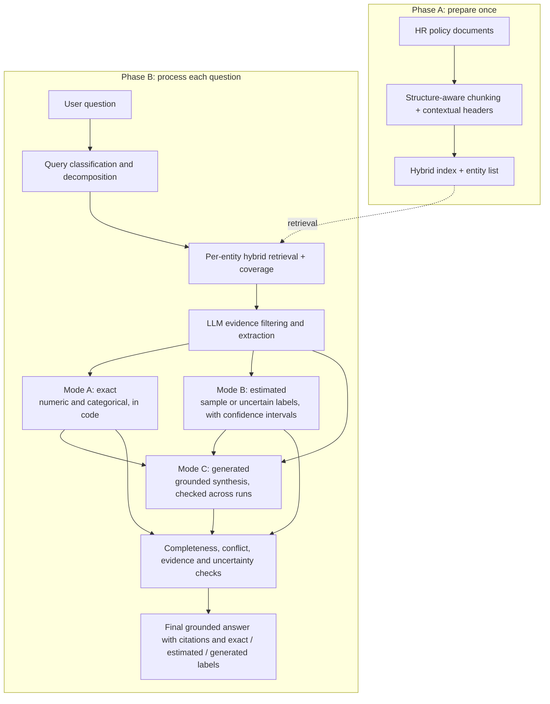

# LensRAG algorithm, explained with a worked example

> Source: the methodology report, `docs/LensRAG_methodology.pdf` (Section 1.1.1 and Figures 1.1–1.2). The figures in the example are fictional and only illustrate the algorithm; they are not findings from the BragsLabs corpus. For how the Python code implements each step, see [`FULL_RUNTIME_GUIDE.md`](FULL_RUNTIME_GUIDE.md).

Think of LensRAG as a system that:

1. reads and indexes the documents once;
2. finds all the relevant evidence for a question;
3. extracts the facts;
4. calculates the answer where possible;
5. checks that nothing important was missed.

The steps below use a fictional company's HR-policy corpus.

## Example scenario

A company has HR policy documents for five countries: **India, United States, United Kingdom, Singapore and Australia**. The documents cover leave policies, benefits, eligibility rules, working hours and other HR information.

An employee asks:

> *Which country offers the highest annual paid leave entitlement? Show the top three countries and their entitlements.*

This is a **global** question. A normal RAG system might retrieve three relevant passages and answer from them, but those three passages might not cover all five countries. LensRAG is designed to solve that coverage problem.

---

## Phase A: Prepare once (offline)

### Step 1: Document ingestion and chunking

*Done before any question arrives.*

Suppose the India handbook contains:

- Annual leave policy
- Sick leave policy
- Maternity leave policy
- Eligibility rules

Instead of splitting the document into arbitrary blocks of text, LensRAG uses **structure-aware chunking**. A resulting chunk looks like this:

| Part | Content |
|---|---|
| Contextual header | Document: India Employee Handbook · Section: Leave Policies → Annual Leave · Country: India · Version: 2026 |
| Chunk content | Employees are entitled to 18 days of annual paid leave per calendar year, subject to the eligibility conditions described in this section. |

The key point is that **the contextual header is embedded together with the chunk content**. If a search later finds the sentence "Employees are entitled to 18 days", the system also knows which country, document, section and version it belongs to.

Tables are kept intact where possible, rather than split in ways that lose their meaning.

### Step 2: Build the index and entity list

LensRAG builds two things:

1. **A searchable hybrid index** of the contextualised chunks:
   - a **BM25 keyword index**, which finds exact words and terms;
   - a **dense vector index**, which finds semantically similar passages.
2. **An entity list** of the countries and other entities in the corpus. For the example: India, United States, United Kingdom, Singapore, Australia.

LensRAG doesn't re-read or re-index the documents for each new question; it reuses the index.

---

## Phase B: Process each question (query time)

### Step 3: Understand and classify the question

For the user's question, LensRAG identifies:

| Aspect | Value |
|---|---|
| Query type | Top-K / ranking |
| Subject | Annual paid leave |
| Scope | All countries |
| Required operation | Extract the number of days and rank countries in descending order |

This matters because a ranking question is solved differently from, say, a question about common themes or employee sentiment.

### Step 4: Decompose the question by entity

Instead of searching once across the whole corpus and trusting the top results, LensRAG uses the entity list to create **bounded subqueries**.

Original question: *Which country has the highest annual paid leave entitlement?*

Entity-specific subqueries:

1. Find India's annual paid leave entitlement.
2. Find the United States' annual paid leave entitlement.
3. Find the United Kingdom's annual paid leave entitlement.
4. Find Singapore's annual paid leave entitlement.
5. Find Australia's annual paid leave entitlement.

A question about all countries needs evidence from all relevant countries, and searching only for the globally most similar passages could leave some out. The entity list makes coverage **bounded and checkable**.

### Step 5: Retrieve evidence using hybrid search

Each subquery uses two complementary retrieval methods, and their results are combined:

| Method | What it finds |
|---|---|
| BM25 | Keyword matches such as "annual leave", "paid leave" and "entitlement" |
| Dense retrieval | Semantically related passages, even when the wording differs |

For example, the Singapore handbook might say "annual vacation entitlement" rather than "annual paid leave". Keyword search alone might miss it; dense retrieval can find it.

- **Coverage:** for global aggregation questions, LensRAG keeps retrieving until more retrieval stops producing new relevant evidence.
- **Filtering:** an LLM then filters the retrieved passages, keeping only those that actually answer the question.

### Step 6: Extract structured evidence

Suppose the system found these fictional policy statements:

| Country | Retrieved policy statement |
|---|---|
| India | 18 days annual paid leave |
| USA | 15 days annual paid leave |
| UK | 25 days annual paid leave |
| Singapore | 14 days annual paid leave |
| Australia | 20 days annual paid leave |

The LLM turns each relevant passage into a temporary structured record. Example:

| Field | Value |
|---|---|
| Entity | India |
| Value | 18 days |
| Evidence span | "Employees are entitled to 18 days of annual paid leave per calendar year." |
| Source | India Employee Handbook → Annual Leave → Version 2026 |

Each record holds three essential pieces: **(entity, value, evidence span)**. These are temporary query-time records; LensRAG does not build a permanent database of every HR fact in advance.

### Step 7: Compute the answer: exact, estimated or generated

Questions aren't only numeric aggregations. They can ask for categories ("which leave type do employees ask about most?"), for proportions over thousands of records, or for open-ended insight ("why is attrition rising?"). Step 7 therefore picks one of three **computation modes** for the question, based on the plan from Step 3. Every result is labelled with its mode, so the final answer says what is exact, what is estimated and what is generated.

One principle holds in all three modes:

- **Code computes everything that can be counted.**
- **Probability is quantified wherever a value is estimated.**
- **The LLM generates only on top of computed facts and cited evidence.**

#### Mode A: exact (deterministic code)

Used when the answer is a calculation over the extracted records. This covers two kinds of data:

| Data | Operations | Example question |
|---|---|---|
| Numeric | count, sum, mean, min/max, rank, top-K, filter by threshold | Which three countries give the most annual leave? |
| Categorical | frequency per category, mode (most common category), share, distribution, group-by, cross-tab, set operations (in both / in either / in one but not the other) | Which leave type do employees ask about most in each country? Which offices have both a gym and a crèche? |

For the running example, the values are ranked in code:

| Country | Days |
|---|---:|
| India | 18 |
| USA | 15 |
| UK | 25 |
| Singapore | 14 |
| Australia | 20 |

Sorted in descending order:

| Rank | Country | Days |
|---:|---|---:|
| 1 | UK | 25 |
| 2 | Australia | 20 |
| 3 | India | 18 |

A categorical example: if each helpdesk record is extracted as (country, leave type), code counts records per leave type within each country and returns the mode, with ties reported as ties.

**The LLM extracts the facts; code does the calculation**, so counts, rankings and category frequencies are reproducible.

#### Mode B: estimated (probabilistic)

Used when an exact computation isn't possible or wouldn't be honest. Two common cases:

- **Too much evidence to read in full.** A question about 6,000 helpdesk tickets can't send every ticket through an LLM. LensRAG draws a random sample per entity (a stratified sample), extracts or labels the sampled records, and computes the estimate in code, with a confidence interval. For example, a Wilson interval for a share, or a bootstrap interval for a mean.
- **Uncertain labels.** When a label comes from an LLM judgement (sentiment, "is this complaint about hybrid work?"), the label itself is uncertain. LensRAG labels each record several times, or asks for a probability per label, and aggregates *expected* counts rather than treating every label as certain.

Example output, with fictional numbers:

| Question | Result |
|---|---|
| What share of 2026 grievances are about hybrid work? | 31% (95% CI 27–36%), from a stratified sample of 400 of 1,697 grievances |
| Did exit sentiment become more negative after April 2026? | Negative share 35% → 54% (difference +19 points, 95% CI +11 to +27), based on labels averaged over three labelling passes |

Rules for this mode:

- **Code computes the estimate, never the LLM.**
- **Every estimate is reported with its sample size and interval.**
- **When the full set is small enough, use Mode A instead.** Sampling is a fallback for scale, not a default.

#### Mode C: generated (grounded synthesis)

Used for questions whose answer is an insight, explanation, comparison or recommendation, rather than a value. Examples: *What are the common themes across employee benefits?* *Why might attrition be rising in India?* *How do India's and the UK's leave policies differ in spirit?*

This mode extends map-reduce:

1. **Map.** For each entity or period, the LLM writes short structured notes from that scope's evidence: labels, observations and the evidence spans that support them.
2. **Compute.** Code adds whatever supporting statistics Modes A and B can provide, such as how many records carry each label or how a share changed between periods.
3. **Reduce.** The LLM writes the insight from the notes and the computed statistics. It may not introduce numbers that code didn't compute.
4. **Check consistency.** The reduce step runs *k* times (for example *k* = 5). An insight is kept only if it appears in most runs, and each kept insight carries its support (for example "4 of 5 runs"). This is a self-consistency check, and turns a single generation into a measured level of agreement.
5. **Ground.** Every kept insight must cite the records or passages it rests on. An insight with no supporting evidence is dropped or marked as a hypothesis.

Example output, with fictional numbers:

> **Insight (support 5/5):** Attrition reasons in India shifted towards office-attendance requirements after April 2026. 41% of exit interviews mention it, against 12% before (computed, Mode A). Cited: EXIT-IN-2026Q2, EXIT-IN-2026Q3.
>
> **Insight (support 3/5):** Commute and transport changes in Bengaluru may compound this, but the evidence is thinner. Cited: GRV-IN-2026Q1. *(Marked as tentative.)*

Generated answers are therefore probabilistic in a stated way. The numbers inside them are exact or estimated with intervals (Modes A and B), and the wording is checked for agreement across runs and tied to cited evidence.

#### Choosing the mode

| The question asks for… | Mode | Who computes |
|---|---|---|
| A number, ranking, filter or set over a manageable set of records | A: exact | Code |
| A category frequency, mode or distribution over a manageable set | A: exact | Code |
| A share, mean or trend over more records than can be read, or over uncertain labels | B: estimated | Code, with confidence intervals |
| Themes, explanations, comparisons in prose, recommendations | C: generated | LLM, grounded in Mode A/B numbers, checked for agreement across runs, with citations |

A single answer can combine modes. An insight (C) usually quotes an exact count (A) or an estimate (B).

### Step 8: Verify completeness and consistency

Before writing the answer, LensRAG checks four things:

1. **Completeness:** were all five countries in the entity list covered?
2. **Conflicts:** did different sections or policy versions give different entitlements for the same country? If one India handbook says 18 days and an older version says 20, the system should flag the conflict rather than silently pick a value.
3. **Evidence support:** can every reported number be traced back to a source passage?
4. **Uncertainty is stated:** does every estimated value (Mode B) carry its sample size and confidence interval? Does every generated insight (Mode C) carry its support across runs and its citations? Unsupported insights are dropped or marked as hypotheses.

### Step 9: Generate the final answer

Only after retrieval, extraction, computation and verification does the system write a natural-language answer. The answer keeps Step 7's labels, so the reader can tell exact figures from estimates and generated insights. An illustrative response:

> Based on the five country handbooks reviewed, the top three annual paid leave entitlements are:
>
> 1. United Kingdom — 25 days
> 2. Australia — 20 days
> 3. India — 18 days
>
> These figures are taken from the annual leave sections of the respective 2026 handbooks.

---

## Not every question follows the same path

LensRAG routes each question type to a suitable processing method:

| Question type | Example | How LensRAG processes it |
|---|---|---|
| Local | What is India's sick leave policy? | Retrieve and answer from evidence |
| Counting | How many countries offer parental leave? | Extract records and count in code (Mode A) |
| Extremum | Which country offers the most leave? | Extract values and compute the maximum (Mode A) |
| Sorting / top-K | Show the top three countries | Extract values and sort in code (Mode A) |
| Filtering | Which countries offer more than 20 days? | Extract values and filter in code (Mode A) |
| Comparison | Compare India and UK leave policies | Retrieve both sets of evidence and compare |
| Categorical | Which leave type do employees ask about most in each country? | Extract categories and count or take the mode in code (Mode A) |
| Proportion over many records | What share of grievances are about hybrid work? | Sample, label and estimate with a confidence interval (Mode B) |
| Theme | What are the common employee benefits? | Map, compute support, reduce (Mode C) |
| Sentiment | What are the common employee concerns? | Label, with uncertainty where labels are LLM judgements (Mode B), then summarise (Mode C) |
| Insight / explanation | Why might attrition be rising in India? | Grounded synthesis checked for agreement across runs, with citations (Mode C) |
| Conflict detection | Are there conflicting leave policies? | Retrieve, compare versions and flag conflicts |

## What map-reduce does

Map-reduce is the core of Mode C (Step 7). Suppose the question is: *What are the common themes across employee benefits in all five countries?*

- **Map:** examine each country's evidence separately and write structured notes: its relevant themes, each with supporting evidence spans.
- **Compute:** code counts how many countries and records support each theme (Mode A), or estimates it from a sample (Mode B).
- **Reduce:** combine the notes and counts into recurring themes, differences and exceptions across countries. Repeat the reduce step several times and keep the themes most runs agree on.

Example output: healthcare benefits (5 of 5 countries), parental support (5 of 5), retirement benefits (4 of 5), employee wellbeing (3 of 5).

Map-reduce isn't used for every query. Exact numeric and categorical operations go straight to code (Mode A).

---

## The complete architecture

## The key idea

LensRAG is not simply "RAG plus an LLM". Its central contribution is the combination of:

1. **Context-enriched indexing.**
2. **Entity-based decomposition**, which makes global coverage manageable.
3. **Hybrid retrieval** that prioritises finding all the relevant evidence.
4. **Query-time extraction** into traceable records.
5. **Three computation modes:** deterministic code for exact numeric and categorical answers, probabilistic estimation with stated uncertainty when evidence is too large or labels are uncertain, and grounded generation, checked for agreement across runs, for insights.
6. **Verification** of completeness, consistency, evidence and stated uncertainty.

This is also what separates LensRAG from RAPTOR. RAPTOR organises information as a hierarchy of summaries, whereas LensRAG's core method uses context-enriched passages, entity-scoped retrieval and query-time evidence aggregation.

## Note on implementation status

The steps above are implemented in the full runtime (`lensrag/full/`; see [`FULL_RUNTIME_GUIDE.md`](FULL_RUNTIME_GUIDE.md)) and evaluated with local models; the results are in the report (`docs/report/corpus-rag-project.pdf`) and the README.

The implementation adds one thing the methodology does not describe. Facts the corpus states in a regular form (table rows, labelled record fields, document metadata) are read once at index time into structures that code can count, rank and filter exactly. A question is answered from these when they cover it, and through steps 3–8 otherwise. This change, not better retrieval, produced most of the accuracy gain: on held-out questions, global exact match is 0.66 against 0.19 for standard RAG with the same model.
