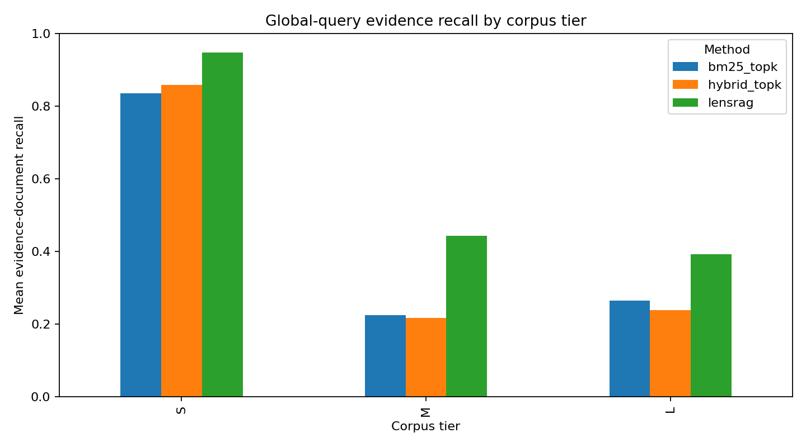
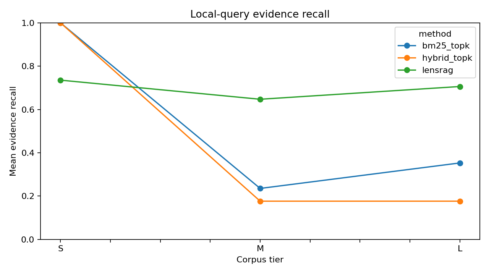

# LensRAG experiment results — BragsLabs HR corpus

**Run status:** completed for S, M and L tiers using the final context-enriched chunker.  
**Evaluation scope:** retrieval/evidence coverage only. No LLM generation, answer extraction, faithfulness judge, long-context prompting or conflict classifier was executed.

## 1. Corpus scale

Token values below are **estimates**, not tokenizer-exact counts: this runtime did not have `tiktoken` or a model tokenizer installed, so tokens are estimated as whitespace word count × 1.33. Install `tiktoken` and rerun to replace these with exact `cl100k_base` counts.

| Tier | Retrievable docs | Chunks | Whitespace words | Estimated tokens | Index build |
|---|---:|---:|---:|---:|---:|
| S | 46 | 580 | 45,069 | 59,942 | 127 ms |
| M | 245 | 3,441 | 250,423 | 333,063 | 649 ms |
| L | 495 | 13,187 | 1,660,802 | 2,208,867 | 3,668 ms |

The full corpus therefore reaches approximately **2.21 million estimated tokens** under this project's transparent 1.33 token/word approximation. Five documents marked `retrieval_exclude` were omitted. Questions were evaluated only at or above their `min_tier`: 34 at S, 60 at M and 89 at L.

## 2. Global-query evidence recall

Evidence recall is the proportion of gold evidence document IDs found in the retrieved unique document set. It is not answer accuracy.

| Tier | Method | Global questions | Mean evidence recall | Median latency |
|---|---|---:|---:|---:|
| S | BM25 top-k | 17 | 0.835 | 0.27 ms |
| S | Hybrid top-k | 17 | 0.859 | 0.96 ms |
| S | LensRAG prototype | 17 | **0.947** | 6.23 ms |
| M | BM25 top-k | 43 | 0.225 | 0.47 ms |
| M | Hybrid top-k | 43 | 0.216 | 3.05 ms |
| M | LensRAG prototype | 43 | **0.443** | 11.86 ms |
| L | BM25 top-k | 72 | 0.265 | 1.23 ms |
| L | Hybrid top-k | 72 | 0.238 | 29.93 ms |
| L | LensRAG prototype | 72 | **0.392** | 38.81 ms |

At Tier L, LensRAG global evidence recall is 0.392 versus 0.265 for BM25 and 0.238 for hybrid top-k. At Tier M, the corresponding values are 0.443 versus 0.225 and 0.216. These gains come with higher retrieval latency and more returned documents.



## 3. Local-query evidence recall

| Tier | BM25 top-k | Hybrid top-k | LensRAG prototype |
|---|---:|---:|---:|
| S | **1.000** | **1.000** | 0.735 |
| M | 0.235 | 0.176 | **0.647** |
| L | 0.353 | 0.176 | **0.706** |

Tier S shows an important regression for the current LensRAG prototype on local lookups. This supports preserving the standard local retrieve-rerank-generate path and routing only global queries to entity decomposition.



## 4. Paired global-question comparisons

Paired question-level difference in evidence recall: LensRAG minus baseline. Confidence intervals are percentile bootstrap intervals over question IDs (5,000 resamples); p-values are unadjusted Wilcoxon signed-rank tests and exploratory.

| Tier | Baseline | N | Mean recall difference | 95% bootstrap CI | Wilcoxon p |
|---|---|---:|---:|---:|---:|
| S | BM25 | 17 | +0.112 | [-0.047, +0.259] | 0.044 |
| S | Hybrid | 17 | +0.088 | [-0.082, +0.241] | 0.075 |
| M | BM25 | 43 | +0.219 | [+0.058, +0.381] | 0.017 |
| M | Hybrid | 43 | +0.227 | [+0.060, +0.395] | 0.017 |
| L | BM25 | 72 | +0.127 | [+0.036, +0.226] | 0.040 |
| L | Hybrid | 72 | +0.154 | [+0.066, +0.245] | 0.014 |

These tests are exploratory and not corrected for multiple comparisons. The confidence intervals for Tier S include zero. Tier M and L comparisons are more encouraging, but should be replicated with the final LLM-backed architecture and a pre-registered analysis plan.

## 5. Hypothesis assessment

### H1 — Standard top-k is weaker on global than local questions
**Status: mixed / not established.** On Tier S, BM25 global recall (0.835) is below local recall (1.000), consistent with H1. At M and L, BM25 global recall is slightly below local recall (0.225 vs 0.235 at M; 0.265 vs 0.353 at L), but these are retrieval-only measurements. H1 also predicts long-context performance changes with corpus scale; no long-context baseline was run. H1 cannot yet be accepted or rejected.

### H2 — LensRAG improves global answer accuracy without reducing local accuracy
**Status: promising retrieval evidence, answer hypothesis untested.** LensRAG improves global evidence recall over both retrieval baselines at all three tiers. However, exact-match accuracy and set-level answer F1 have not been measured. Local retrieval recall is lower at S, so the “without reducing local accuracy” condition is not demonstrated. A router that sends local queries to the ordinary top-k path is a priority ablation.

### H3 — Completeness and conflict checks detect most errors with low false alarms
**Status: not tested.** This experiment does not run an LLM evidence verifier or conflict classifier. The 12 planted conflict records and legitimate version changes in the corpus provide the basis for a dedicated labelled evaluation, but no detection precision/recall is claimed.

## 6. Interpretation and next work

1. Keep the local path unchanged; route only global/aggregation questions to entity coverage retrieval.
2. Improve global recall with candidate filtering and adaptive stopping. Current per-country retrieval increases coverage but also latency and irrelevant-document volume.
3. Add neural embeddings (e.g. a fixed BGE-M3 revision) and compare against BM25 + TF-IDF; current hybrid retrieval is lexical TF-IDF, not neural dense retrieval.
4. Implement LLM filter/extract records with exact evidence spans; compute counts/ranks/filters in Python.
5. Evaluate long-context and GlobalRAG-style baselines on the same question IDs and context/token budget.
6. Evaluate conflict detection against the planted conflicts, with legitimate version changes as negative controls.
7. Use exact tokenizer-based input/output token accounting and at least three runs for nondeterministic LLM methods.

## 7. Reproducibility

Run:
```bash
pip install -r requirements.txt
python -m lensrag.cli run --tiers S M L --top-k 10 --output results
```

Raw per-question results are in `metrics.csv`; grouped values are in `summary.csv`; exact run configuration and corpus-scale counts are in `run_config.json`.

**Research integrity:** these retrieval results were generated by executing the included code on the uploaded corpus. They are not copied from the illustrative table in the PDF. No answer-accuracy or conflict-detection result has been fabricated.
